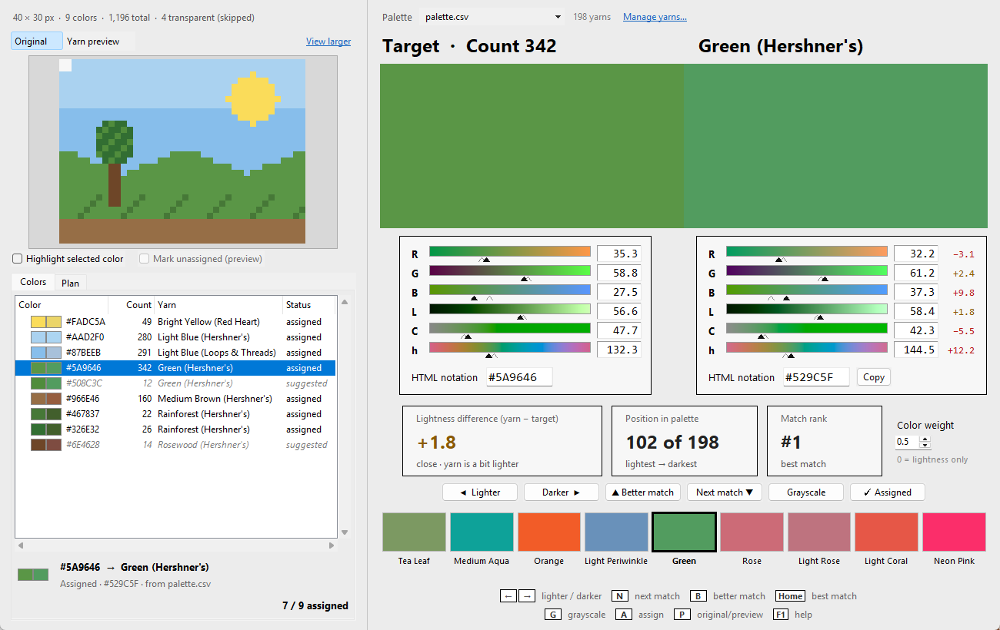
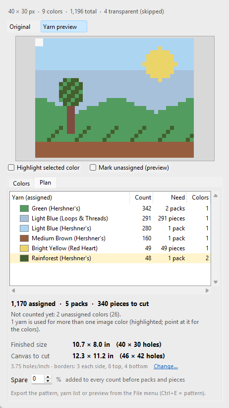
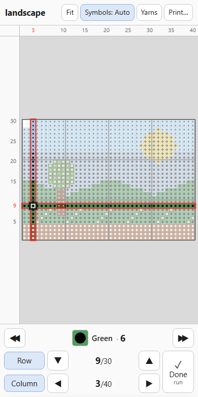
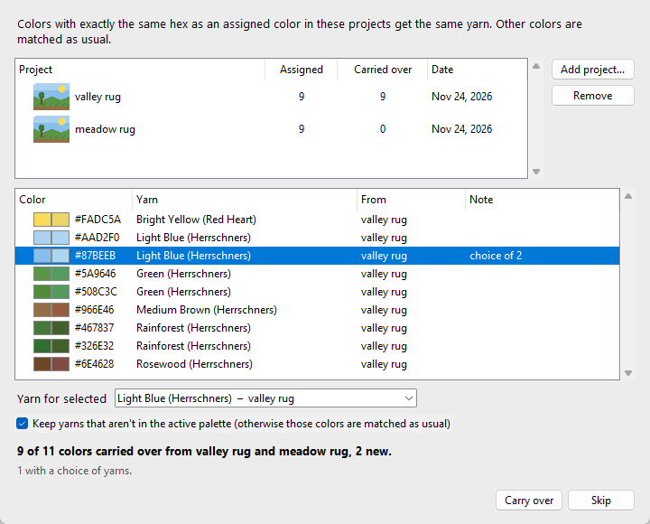
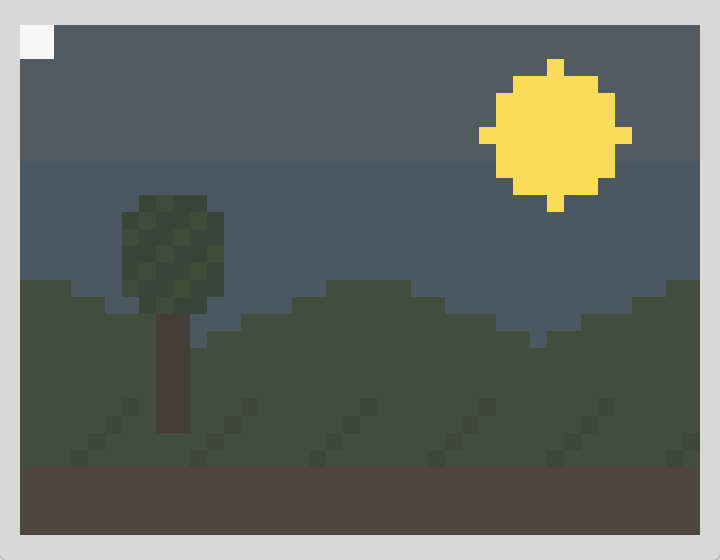
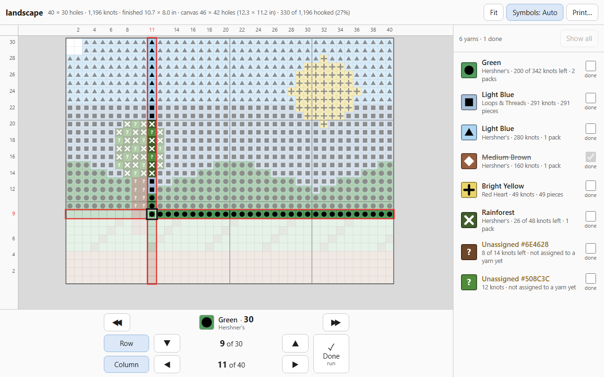
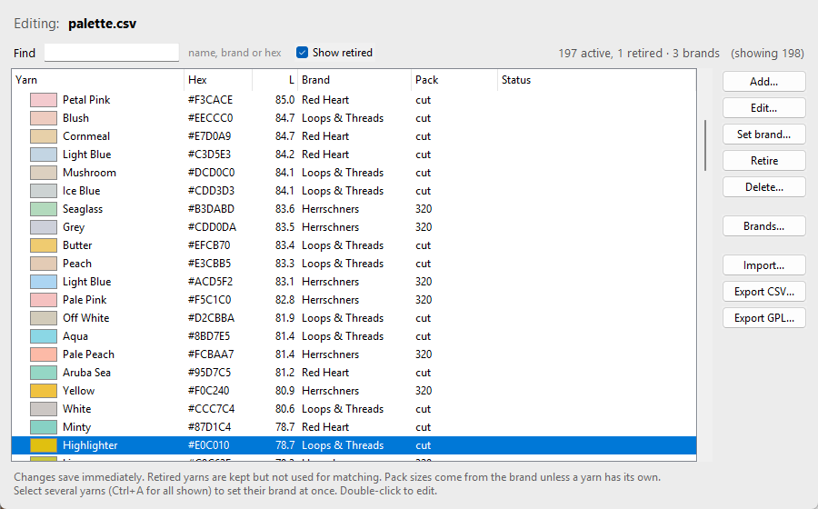
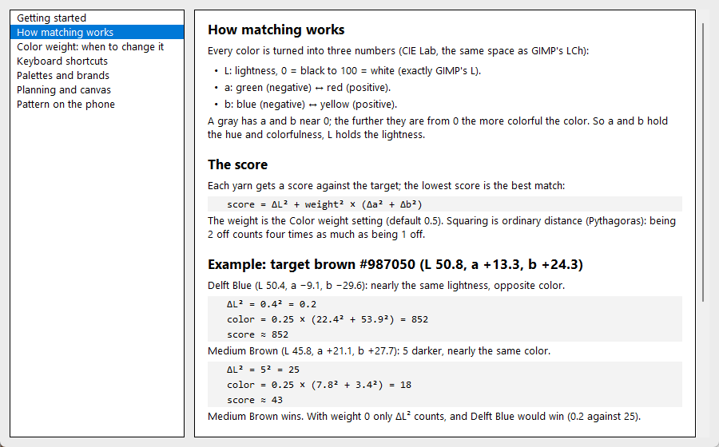

# Latchwork

A desktop tool for making latch-hook rugs from pixel art. It takes a pixel-art image to a
finished pattern: match every image color to a yarn, plan how much yarn and canvas you need,
and export a pattern you can read on your phone while hooking.



## What it does

- **Matches colors to yarn.** Pick an image color and Latchwork shows it side by side with the
  best-matching yarn from your palette, ranked by lightness first and color second. Step
  through the alternatives with the keyboard and assign the one you like.
- **Plans the rug.** Packs (for pre-cut yarn) or pieces to cut per yarn, finished size, and
  how much canvas to cut including the folded borders.
- **Exports a pattern.** One self-contained HTML file: pinch-zoom grid with symbols, a legend,
  done checkmarks per yarn, and row and column trackers that read out the yarn at your spot
  and mark runs, rows or columns as hooked.
  Works offline on a phone, and prints on letter paper split into labelled pages.
- **Manages your yarn palette.** Add, edit, retire and import yarns (CSV or GIMP `.gpl`), with
  brands and pack sizes. Keep several palettes and switch between them instantly.
- **Comes with a ready-made palette** of 198 yarns from Herrschners, Red Heart and Loops &
  Threads, so you can start matching right away (see [The yarn palette](#the-yarn-palette)).

<p>
  
  &nbsp;
  
</p>

## Getting started

You need **Python 3.8 or newer with Tkinter**. There is nothing else to install.

- **Windows:** install Python from [python.org](https://www.python.org/downloads/) (Tkinter is
  included). Then double-click **`latchwork.bat`**.
- **macOS:** install Python from [python.org](https://www.python.org/downloads/) (includes
  Tkinter), or `brew install python-tk`. Then double-click **`latchwork.command`**. The first
  time, macOS may ask you to right-click → Open.
- **Linux:** install Python and Tkinter with your package manager, e.g.
  `sudo apt install python3 python3-tk`. Then run **`./latchwork.sh`**.

Or from a terminal on any system: `python latchwork.py`. The launcher checks Python and Tkinter
first and tells you what's missing.

## How to use it

1. **File → New project from image** and pick a pixel-art PNG, GIF or BMP. The image is stored
   inside the `.latchwork` project file, so moving the original never breaks the project.
   Projects save automatically.
   Making several rugs from one game? Pick earlier projects when asked, and every color with
   exactly the same hex starts with the yarn you used before.
   Already patterned a rug by hand? **File → Assign from yarn image** reads your yarn-colored
   copy of the art (same size) and assigns every color that matches a yarn exactly.

   
2. **Colors tab:** click a color in the list (or in the image) to make it the target.
3. The main view shows the target next to its best yarn match. Use **N** / **B** to walk down
   and up the match ranking, **← →** (or the mouse wheel over the yarn strip) to step through
   the palette by lightness, **G** to compare in grayscale. Deciding between a few? **M** marks
   the yarn on screen as a candidate (or right-click its tile) and **C** (or a middle-click)
   flips between your candidates. Press **A** to assign the yarn on screen.
   For small, long or wide art, **View larger** (above the sidebar image) opens the picture in
   its own window. With *Highlight selected color* on, everything but the selected color fades,
   toward dark gray around a light color like this sun.

   
4. **Plan tab:** packs or pieces per yarn, finished size and canvas to cut. Canvas settings
   (holes per inch, borders) are per project under *Change…*.
5. **File → Export pattern** (Ctrl+E) writes the HTML pattern. Copy it to your phone and open
   it in the browser. Turn on the row and column trackers to read one cell at a time, and press
   **Done** as you go: hooked cells fade, and the pattern keeps count of what's left.

   

Press **F1** for the built-in help, including how matching works and when to change the color
weight.

## The yarn palette

`data/palette.csv` ships with 198 yarns from Herrschners, Red Heart and Loops & Threads. Their
colors were sampled from photos, so treat them as close approximations. Pack sizes per brand are
in `data/palette.brands.csv` (Herrschners comes pre-cut, 320 pieces per pack; the others are cut
from skeins).

To use your own yarns, open **Palette → Manage yarns** (Ctrl+P) to add or edit them, or start
an empty palette with **File → New palette**. Palettes are plain CSV files you can also edit in
a spreadsheet.



## How matching works

Every color is converted to CIE Lab, the same color space as GIMP's LCh selector. Each yarn is
scored against the target as `ΔL² + (weight × color difference)²`, and the lowest score is the
best match. Lightness leads; the **Color weight** (default 0.5) lets hue and colorfulness count
too, so a brown target finds a brown yarn rather than a gray of nearly the same lightness. The
default was fitted on real finished rugs. Details are in [docs/DESIGN.md](docs/DESIGN.md) and
in the app under **Help → How matching works**.



## Project layout

```
latchwork.py        launcher (latchwork.bat / .command / .sh wrap it)
src/latchwork/      the application
data/               yarn palettes (CSV)
settings/           your settings, created on first run (not in git)
docs/               design notes and screenshots
tests/              unit tests: python -m unittest discover -s tests
tools/              the GIMP script that exported the original palette
```

## More

- [docs/DESIGN.md](docs/DESIGN.md): color math, matching, file formats and design decisions.

## License

[MIT](LICENSE)
